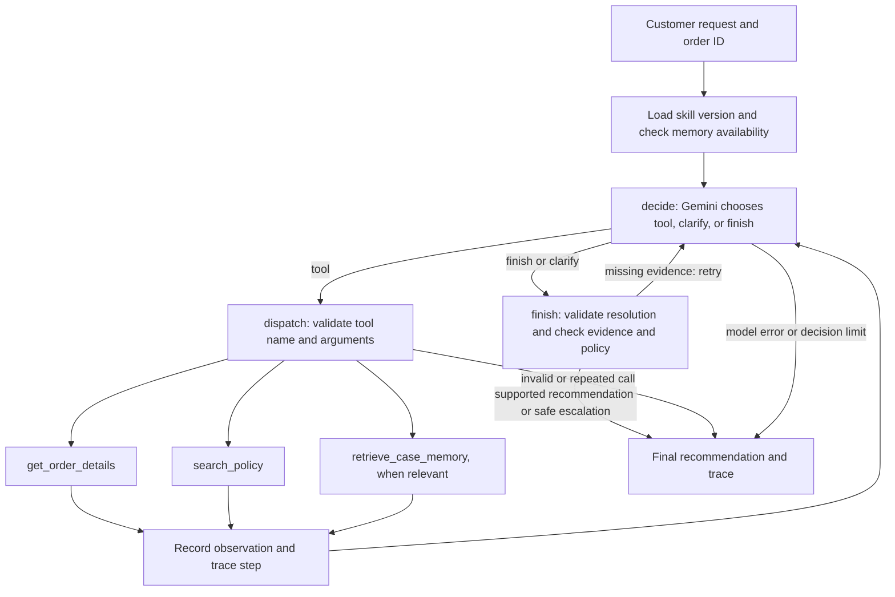
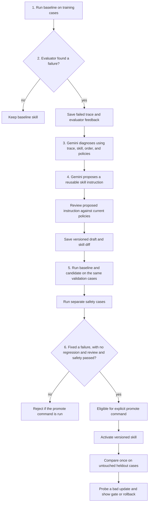

# Agent Improvement Lab

A fictional customer-support agent that recommends resolutions, evaluates its own traces, and tests versioned procedural updates. Gemini chooses read-only information tools inside a bounded LangGraph loop. A separate controller can propose a skill patch after an externally scored failure. No order, payment, refund, shipment, or warranty action is executed.

## Setup with uv

Requires Python 3.11+, [uv](https://docs.astral.sh/uv/getting-started/installation/), and a Gemini API key.

```bash
uv sync --locked
cp .env.example .env
# Put GEMINI_API_KEY in .env, then run:
uv run --locked python demo.py case --case-id C-14
```

`GEMINI_MODEL` defaults to `gemini-2.5-flash`. To send traces to LangSmith, set `LANGSMITH_API_KEY`, `LANGSMITH_TRACING=true`, and `LANGSMITH_PROJECT=agent-improvement-lab` in `.env`. The same local JSON trajectory is saved when LangSmith is unavailable. Keep `.env` private.

For the customer chat and operator viewer:

```bash
uv sync --locked --extra dashboard
uv run --locked --extra dashboard streamlit run app/customer_chat.py
uv run --locked --extra dashboard streamlit run app/demo_dashboard.py
```

The customer chat is a small demonstration using fictional orders. Browser session state holds the conversation; restarting Streamlit starts a new conversation. Case memory is separately persisted in SQLite. There is no ownership authentication.

## Agent graph

`SupportAgent.run_case` loads the selected skill version and checks whether scoped case memory exists. It then invokes a bounded LangGraph with three nodes: `decide`, `dispatch`, and `finish`.



Gemini chooses the next step and fills the structured `Resolution`. `get_order_details` and `search_policy` read fictional records; `retrieve_case_memory` reads scoped historical context. `create_resolution` validates the proposed output inside `finish`; it does not carry out a refund or shipment. The safety check requires current evidence, checks the recommendation against policy and order facts, and can request missing evidence or return a safe escalation. The graph allows at most eight Gemini decisions.

For the code walkthrough, open `agent/graph.py` for the nodes and edges, `agent/tools.py` for the three business functions, `agent/prompts.py` for the output schemas, `skills.md` for the starting procedure, and `agent/data/policies.json` for the authoritative rules.

## Learning flow

The improvement controller runs after the agent. Gemini diagnoses an observed failure and writes a candidate instruction; the evaluator and gate decide whether that candidate is eligible for promotion. The deterministic policy check is a safety boundary, not the learning mechanism.



The example to narrate is **C-14**: a customer requests a refund for final-sale earbuds with a confirmed defect at day 40. The baseline can correctly describe a warranty in its reply while outputting `action=deny`; the safety guard then escalates the mismatch. **C-25** is the separate validation case for the same instruction gap. **C-26** and **C-27** are gift-timing cases; C-26 passed in the observed baseline, so it is an additional edge case rather than the failure being diagnosed.

## Run the walkthrough

```bash
uv run --locked python demo.py baseline
uv run --locked python demo.py diagnose
uv run --locked python demo.py propose
uv run --locked python demo.py validate
```

Run `uv run --locked --extra dashboard streamlit run app/demo_dashboard.py` to inspect the trace, diagnosis, skill diff, paired validation, and gate after each command. The commands above leave the proposal inactive. Inspect the gate before taking any further action. If you later choose to activate a candidate that passed the gate, run `uv run --locked python demo.py promote`, then `compare`, `publish-langsmith`, and `safeguard`. `rollback` restores the previous active version.

`demo.py demo` runs the whole sequence and automatically invokes the promotion decision, so use the staged commands above while leaving proposals unaccepted. `--run-dir PATH` selects a run; otherwise commands use `runs/latest.txt`. `--trace-id UUID` selects a specific failed training trace. `case --case-id C-07 --version active` checks a promoted skill. `--skill-version ID` loads a particular stored version, and `--memory-snapshot PATH` loads an existing case-memory SQLite snapshot for a single case. Paired validation and holdout runs create their own frozen snapshots. `reject` records an operator rejection. `seed-memory` inserts a clearly labeled fictional prior day-eight defect recommendation for the memory walkthrough. `record-memory --case-id C-03` records a proposed summary after a saved single-case assessment. `publish-langsmith` publishes the saved heldout outputs as LangSmith experiments without making new Gemini calls.

The baseline run scores the training cases and queues one job for each observed failure. The controller diagnoses one selected job using trace step IDs, proposes a skill patch against `skills.md`, reviews it against current policies, runs paired validation and an independent safety suite, then promotes only if at least one validation failure is fixed with no passing-case regression or new critical failure. The promoted text is saved as `runs/<run>/active-skills.md` and in SQLite. `rollback` restores its previous active version across process restarts. The eight heldout cases are run once for final comparison; subsequent `compare` calls read the saved report.

`skills.md` is the initial v1 procedure. It deliberately omits explicit guidance on mapping a customer's requested remedy to the structured `action` when policy supports a different remedy. C-14 combines a final-sale defect with a refund-only request; C-25 tests the same gap on another item in validation. C-26 and C-27 test a gift recipient's later receipt against the policy clock, which starts at order delivery. Gemini may or may not fail on a given run; diagnose only an observed failure. The candidate lesson is proposed by Gemini from the trace and reviewed against policy before paired validation. The intentionally misleading refund shortcut is tested as an isolated candidate and remains inactive. The safety layer also checks current order and policy facts before any non-escalation recommendation is shown.

The three functions in `agent/tools.py` are `get_order_details`, `search_policy`, and `create_resolution`. The first two read fictional data; the third validates a recommendation. `retrieve_case_memory` is an optional read from `agent/case_memory.py`. A controller-gated write records only short, scoped summaries with provenance and a proposed or human-confirmed status. A proposed action is never recorded as an executed outcome. Tombstones preserve corrections in the audit trail.

`runs/` contains per-case trajectories, evaluator reports, improvement jobs with skill diffs and gate decisions, versioned SQLite data, and a final comparison. The reports include trace IDs and LangSmith run IDs when available. Inspect actual scores before a presentation; no improvement is guaranteed by a model call.

## Tests

```bash
uv run --locked python -m unittest discover -s tests -v
```

The tests use deterministic fake model decisions to verify graph bounds, optional tool trajectories, memory scope, chat intake, the policy gate, heldout reuse, and rollback. They do not establish a live Gemini success rate.
